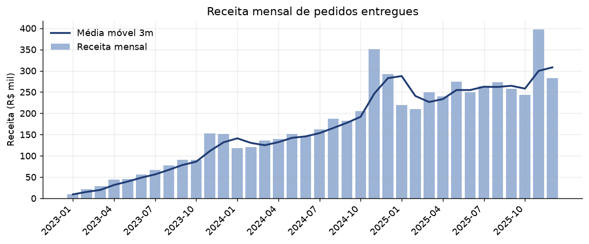
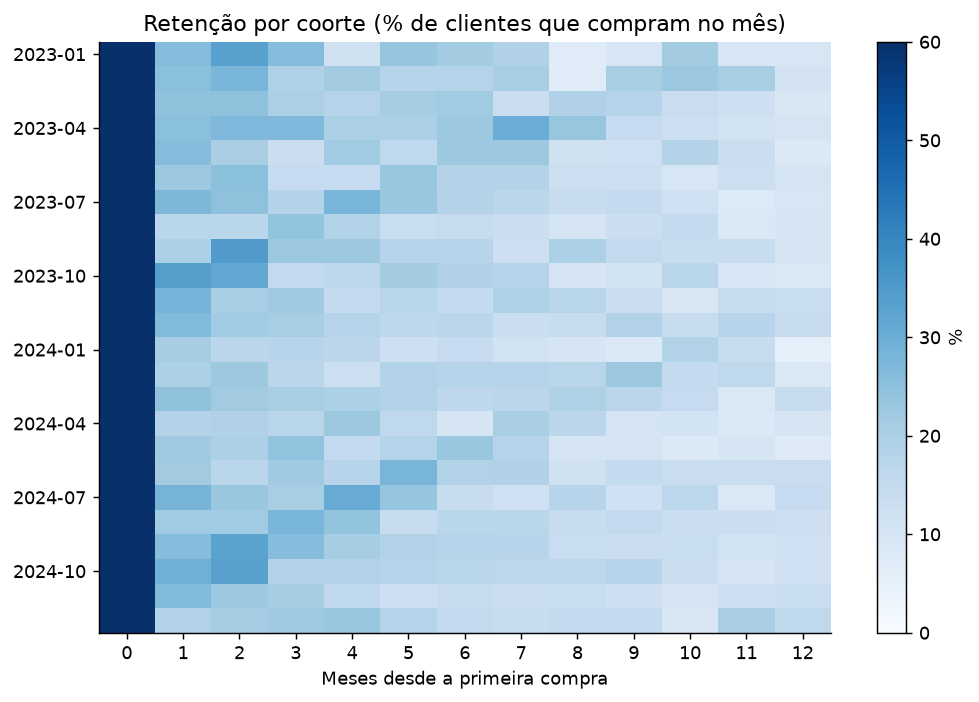
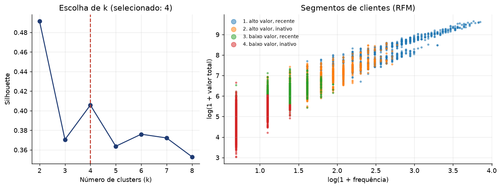
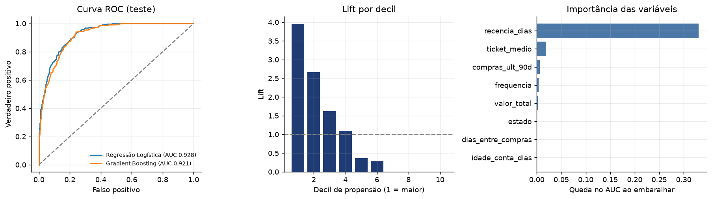

# Segmentação de Clientes e Previsão de Recompra em E-commerce

Projeto de análise de dados ponta a ponta: consultas SQL avançadas, análise exploratória, segmentação RFM com K-Means e modelos preditivos de classificação e regressão para apoiar decisões de CRM e marketing.

> **Aviso sobre os dados:** a base é **sintética**, gerada por `src/generate_data.py` com seed fixa (reprodutível). Ela simula clientes com perfis de compra diferentes, sazonalidade de fim de ano, cupons e cancelamentos. Os números abaixo descrevem este conjunto simulado e **não** representam resultados de um negócio real. Em dados reais, métricas de modelos costumam ser menores.

## Perguntas de negócio

1. Como a receita evolui e qual o efeito da sazonalidade (Black Friday)?
2. Quanto tempo os clientes continuam comprando após a primeira compra (retenção por coorte)?
3. Quais grupos de clientes existem e quanto cada um representa da receita?
4. Quem tem maior chance de recomprar nos próximos 90 dias, para priorizar campanhas?
5. Quanto esses clientes devem gastar nesse período?

## Principais resultados

**Base:** 6.000 clientes, 28.068 pedidos (26.953 entregues), receita de R$ 6,19 milhões e ticket médio de R$ 229,68.

| Tema | Resultado |
| --- | --- |
| Sazonalidade | A receita de nov/2024 foi 70,9% maior que a de out/2024 |
| Retenção | Em média, 24,2% dos clientes de uma coorte compram de novo no mês seguinte à primeira compra |
| Segmentação (K-Means, k=4, silhouette 0,406) | 13,4% dos clientes (alto valor e recentes) geram 62,1% da receita; 46,0% dos clientes (baixo valor e inativos) geram 7,3% |
| Classificação (recompra em 90 dias) | Regressão Logística: ROC AUC 0,928 no teste (0,918 ± 0,010 em validação cruzada), PR AUC 0,801, precisão 0,737, recall 0,685. Taxa base de recompra: 22,4% |
| Priorização de campanhas | O 1º decil de propensão tem lift de 3,96. Contatar os 20% de clientes com maior score captura 66,4% de quem recompra, e os 30% captura 82,6% |
| Regressão (gasto em 90 dias, só quem recompra) | Gradient Boosting: MAE R$ 352,65, RMSE R$ 550,41, R² 0,469, contra MAE R$ 550,16 do baseline pela média |

### Receita mensal



### Retenção por coorte



### Segmentação RFM



### Modelo de recompra



## Estrutura

```
.
├── data/                     # loja.db (SQLite) é gerado localmente
├── reports/                  # gráficos (PNG), tabelas (CSV) e métricas (JSON)
├── sql/
│   ├── 01_receita_mensal.sql           # LAG e média móvel (funções de janela)
│   ├── 02_retencao_coortes.sql         # CTEs encadeadas e retenção por coorte
│   ├── 03_receita_categoria_canal.sql  # JOINs, RANK e participação por canal
│   └── 04_features_cliente.sql         # tabela analítica com corte temporal
├── src/
│   ├── generate_data.py      # gera a base sintética em SQLite
│   └── analysis.py           # EDA, segmentação, classificação e regressão
├── requirements.txt
└── README.md
```

## Como executar

```bash
python -m venv .venv
source .venv/bin/activate        # no Windows: .venv\Scripts\activate
pip install -r requirements.txt

python src/generate_data.py      # cria data/loja.db
python src/analysis.py           # gera tudo em reports/
```

O arquivo `reports/clientes_segmentados.csv` traz uma linha por cliente com o segmento e as variáveis do modelo, e pode ser importado em ferramentas de BI como Power BI ou Tableau.

## Decisões técnicas

- **Corte temporal contra vazamento de dados (data leakage):** as variáveis usam apenas pedidos até 30/09/2025. Os alvos (recompra e gasto) olham os 90 dias seguintes. A lógica fica toda em `sql/04_features_cliente.sql`.
- **SQL para preparar dados, Python para modelar:** agregações, janelas e coortes rodam no banco, perto dos dados. O Python recebe uma tabela já limpa e consolidada, o que é mais escalável para volumes maiores.
- **Escolha do número de clusters:** silhouette para k de 2 a 8. Exigi pelo menos 3 segmentos por utilidade de negócio (k=2 tem silhouette maior, mas separa pouco), e entre 3 e 6 o melhor foi k=4. Recência, frequência e valor passam por `log1p` e padronização antes do K-Means por serem muito assimétricos.
- **Baselines e comparação de modelos:** Regressão Logística contra Gradient Boosting na classificação, e Ridge e Gradient Boosting contra a média na regressão. A Regressão Logística empatou ou superou o Gradient Boosting, então o modelo mais simples e interpretável foi mantido.
- **Métricas coerentes com o objetivo:** ROC AUC e PR AUC (classes desbalanceadas), precisão e recall, validação cruzada estratificada, lift e ganho acumulado por decil para decisões de campanha, e MAE, RMSE e R² na regressão.
- **Importância por permutação:** mede a queda do AUC ao embaralhar cada variável no conjunto de teste. A recência domina o resultado.

## Limitações e próximos passos

- Dados sintéticos: a forte influência da recência vem das regras de simulação (clientes deixam de comprar ao longo do tempo). Em produção, validar com dados reais.
- Um único corte temporal. O ideal é validar com vários cortes (validação por janelas móveis).
- Sem ajuste fino de hiperparâmetros nem calibração de probabilidades.
- Próximos passos: dashboard de acompanhamento, versão do pipeline em PySpark para volumes grandes e execução em nuvem (AWS).

## Tecnologias

Python, SQL (SQLite), pandas, NumPy, scikit-learn, Matplotlib.
